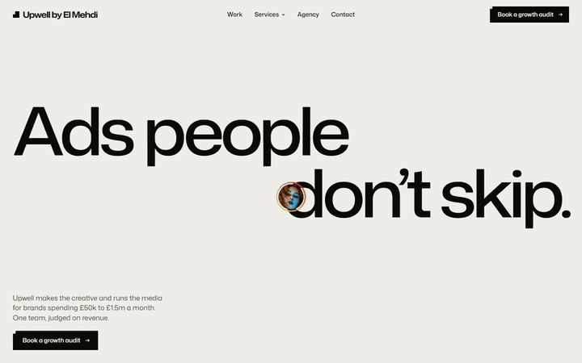
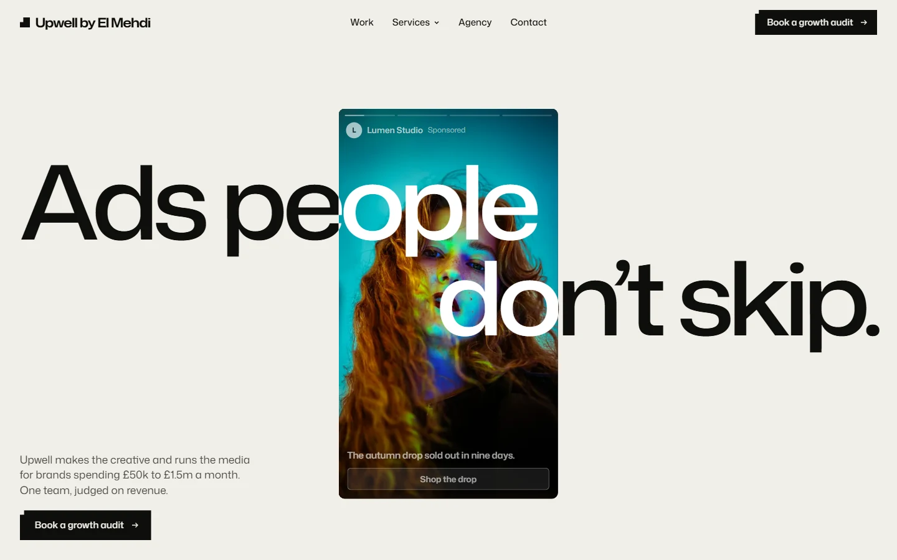
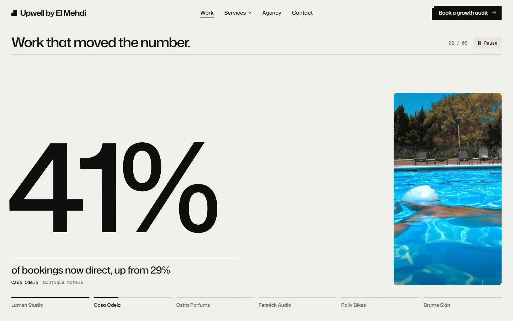
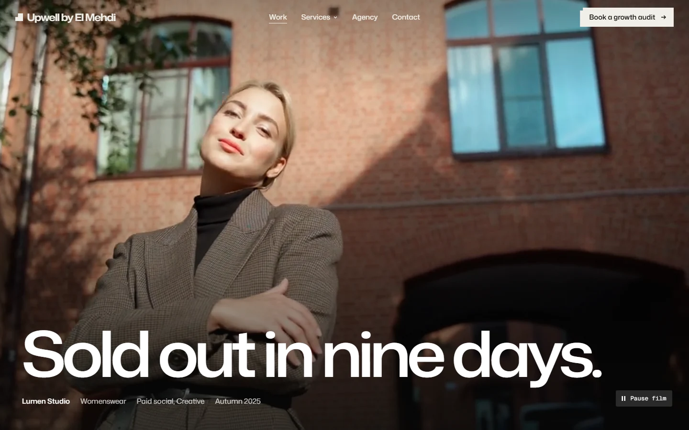
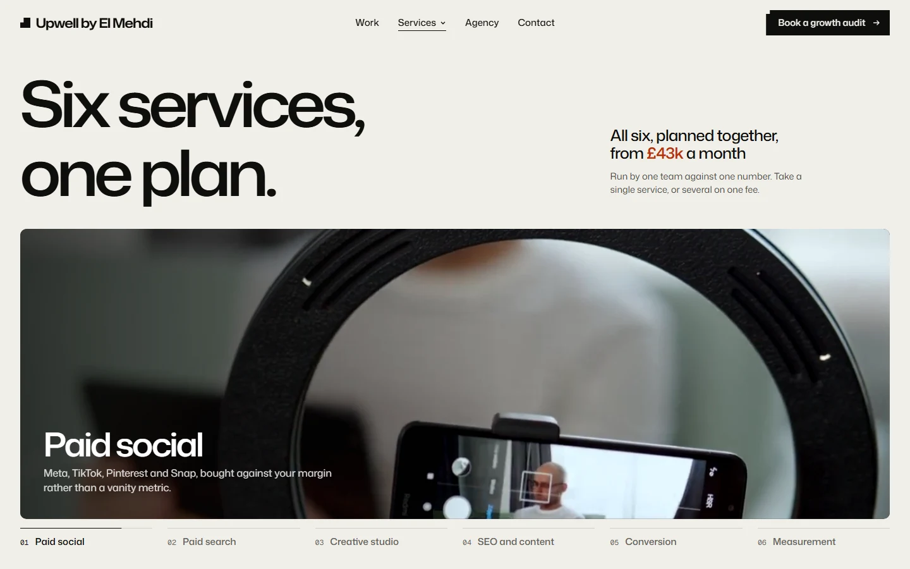
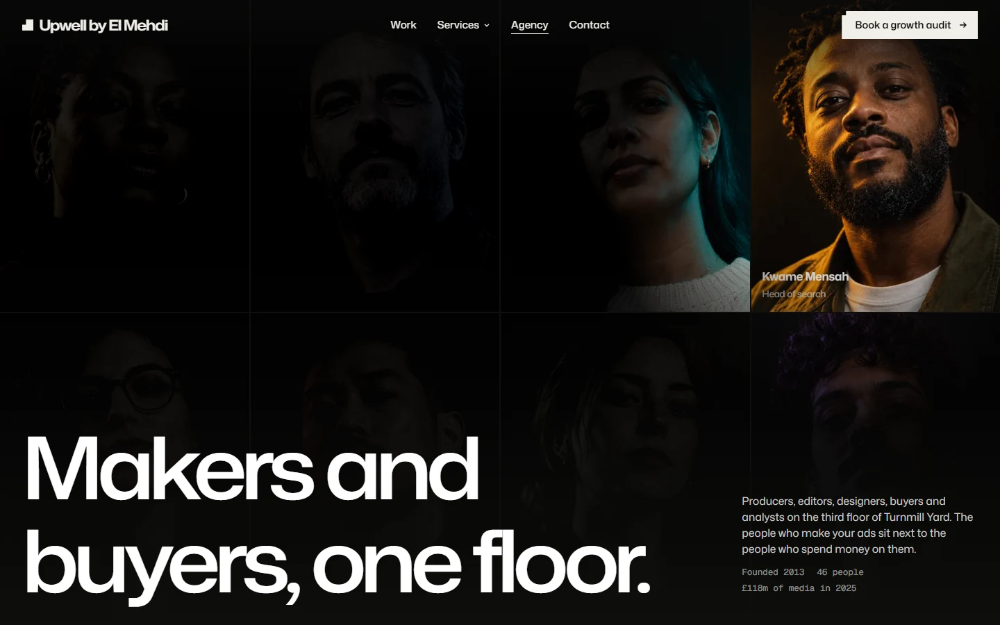
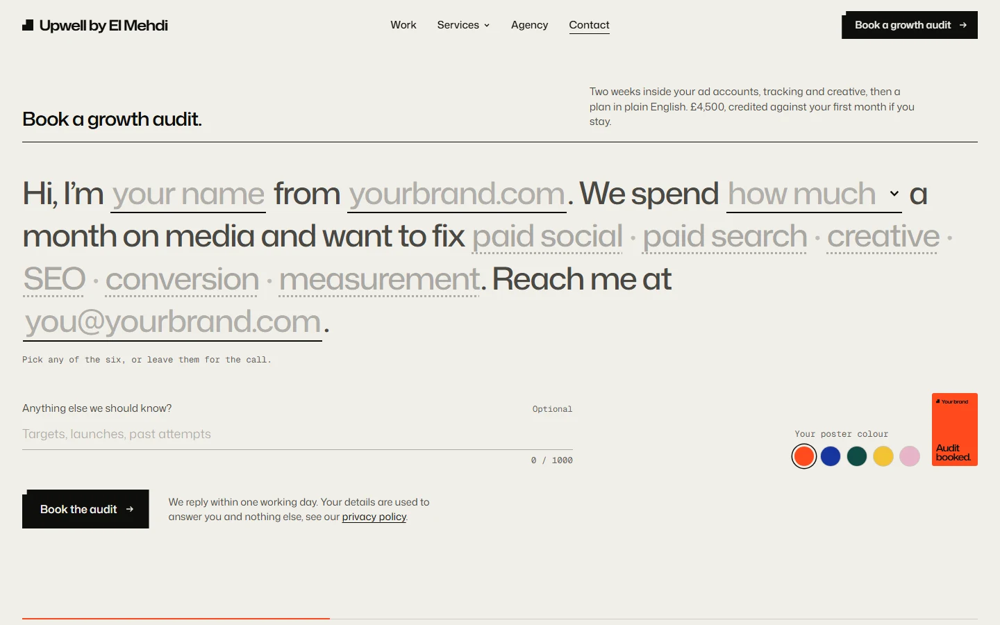
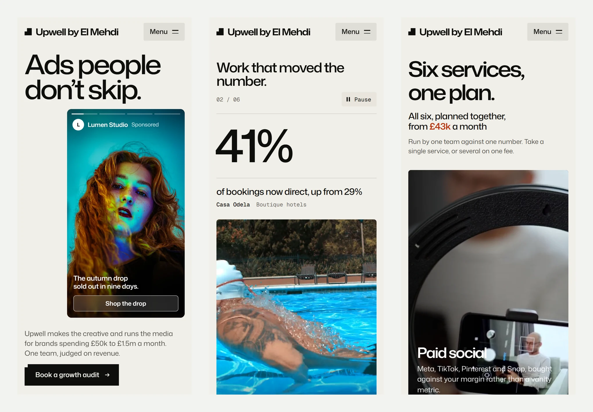

<div align="center">

# Upwell by El Mehdi

### A creative and paid media agency website: work, services, agency and a growth-audit form

13 static pages with GSAP scroll animations, autoplay ad "stories", a case-study slider, a live fee calculator<br>
and a fill-in-the-blanks contact form. Responsive, self-hosted assets, deployed on Netlify.

[](https://upwell-by-elmehdi.netlify.app/)


<br>

<a href="https://upwell-by-elmehdi.netlify.app/"></a>

</div>

<br>

## ✦ Highlights

- **Ad "stories" hero**: the headline wraps around a phone-style story card that cycles through client ads with progress bars, like a real social feed
- **"Forty-two hooks. Three winners."**: a scroll-driven wall of ad videos that thins out to the three winning hooks
- **Case-study slider**: six results ("41 % of bookings now direct") that autoplay with a progress bar, pause button and counter
- **Live fee calculator**: pick a monthly spend (£80k, £400k, £1m) and the fee bands fill in to show how much of each tier you use and what you pay
- **Fill-in-the-blanks contact form**: "Hi, I'm … from … We spend …" with service chips, a poster-colour picker that previews your "audit booked" card, inline validation and a copy-email button
- **Motion details**: GSAP + ScrollTrigger reveals, Lenis smooth scrolling, a logo-fill loader, custom cursors, an "open now" indicator on local time, with `prefers-reduced-motion` support
- **Responsive video**: 1080p films on desktop, lighter versions picked automatically on phones, posters until they load
- **Fast static hosting**: no server code, immutable caching for hashed assets, a custom 404 page and `/x` → `/x/` redirects

<br>

## ✦ Screenshots

<table>
  <tr>
    <td width="50%"><p align="center"><b>Home</b>: the stories hero</p></td>
    <td width="50%"><p align="center"><b>Work</b>: six results, one slider</p></td>
  </tr>
  <tr>
    <td width="50%"><p align="center"><b>Case study</b>: Lumen Studio</p></td>
    <td width="50%"><p align="center"><b>Services</b>: six services and the fee calculator</p></td>
  </tr>
  <tr>
    <td width="50%"><p align="center"><b>Agency</b>: the team</p></td>
    <td width="50%"><p align="center"><b>Contact</b>: book a growth audit</p></td>
  </tr>
</table>

### On phone

<p align="center"></p>

<br>

## ✦ Pages

| Route | Page |
|---|---|
| `/` | Home: stories hero, services, the 42-hooks wall, first 90 days, results, testimonials, pricing, FAQ, call-out |
| `/work/` | Work index: case-study slider and the numbers, client by client |
| `/work/<project>/` | 6 case studies: Lumen Studio, Casa Odela, Ostra Parfums, Fennick Audio, Rally Bikes, Brume Skin |
| `/services/` | Paid social, paid search, creative studio, SEO and content, conversion, measurement + fee calculator |
| `/agency/` | The team, how we work, the studio, open roles |
| `/contact/` | Growth-audit form, email, phone, opening hours |
| `/privacy/` · `/terms/` | Privacy policy and terms |
| any other URL | Custom 404 page |

<br>

## ✦ Stack

| | |
|---|---|
| **Frontend** | Static HTML + CSS + JavaScript built with Astro (hashed bundles in `site/_astro/`), GSAP + ScrollTrigger, Lenis smooth scroll |
| **Assets** | Self-hosted WOFF2 fonts (Mona Sans, Geist Mono), responsive WebP images, H.264 videos in desktop and phone sizes |
| **Hosting** | Netlify (static, no build step), security and cache headers in `netlify.toml` |

Based on the **Upwell** website template by [Visuvate](https://visuvate.com/), customised with my own details and branding.

<br>

## ✦ Getting started

Needs only Node.js 18+ (no dependencies to install).

```bash
git clone https://github.com/elmehdi-sekrare/upwell-by-elmehdi.git
cd upwell-by-elmehdi
npm start    # → http://localhost:5331
```

`scripts/serve.mjs` follows the same rules as Netlify: `/work` → `/work/`, missing pages → `404.html`, byte ranges for video.

<br>

## ✦ Deploy

1. Netlify → **Add new site → Import an existing project** → pick this repo.
2. Leave the build settings as they are: `netlify.toml` already sets **publish directory `site`** and no build command.
3. **Deploy**. Every push to `main` redeploys.

The contact form has no backend: it validates and shows the "audit booked" screen in the browser. To receive messages, connect Netlify Forms or an API.

<br>

## ✦ Project structure

```
upwell-by-elmehdi/
├── site/                 # the website, served as is
│   ├── index.html        # home
│   ├── work/             # work index + 6 case studies
│   ├── services/ agency/ contact/ privacy/ terms/
│   ├── 404.html          # not-found page
│   ├── _astro/           # hashed JS bundles (GSAP, ScrollTrigger, page scripts)
│   ├── fonts/            # self-hosted WOFF2 fonts
│   ├── img/  og/         # photos and share images
│   ├── video/            # films + posters (desktop and phone sizes)
│   └── cursor/           # custom cursor icons
├── scripts/serve.mjs     # local preview server (Netlify rules)
├── docs/                 # README images
├── netlify.toml          # publish dir + headers
└── package.json          # npm start
```

<br>

## ✦ Contact

**El Mehdi Sekrare**: web developer, Mohammedia, Morocco

[](https://www.linkedin.com/in/el-mehdi-sekrare-77000629b)
[](mailto:elmehdisekrare@gmail.com)
[](https://github.com/elmehdi-sekrare)
